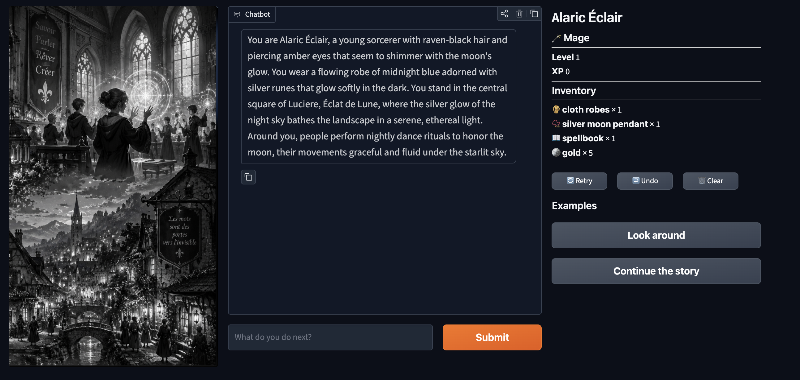

# Le Role Playing Game

A tiny text adventure. A local LLM plays game master and narrates each
beat as you type what you do next. Served over a Gradio chat UI.

Based on the DeepLearning.AI "Interactive AI Applications" lesson,
rewired to run on local Ollama instead of Together AI, with Lunevraie
as the world.



## Prerequisites

- macOS or Linux
- Python 3.13
- [Ollama](https://ollama.com) running on `localhost:11434`
- Models pulled:
  - `ollama pull qwen2.5:14b` (game master)
  - `ollama pull llama-guard3:1b` (moderation)

Verify Ollama is reachable:

```
curl -s http://localhost:11434/api/tags | head -c 200
```

## Install

```
python3 -m venv .venv
.venv/bin/pip install -r requirements.txt
.venv/bin/pip install -U gradio audioop-lts
```

The second line is the Python-3.13 fix:

- `-U gradio` upgrades Gradio to 6.x, which pulls fastapi/starlette/
  jinja2/huggingface_hub versions that work on 3.13. The pinned
  Gradio 4.44.1 from `requirements.txt` chains to deps that break on
  3.13 and does not expose the `Origin` theme.
- `audioop-lts` restores the `audioop` module that Python 3.13 removed
  (pydub, pulled in transitively, imports it).

## Run

```
.venv/bin/python game.py
```

The script:

1. Loads the world from `WORLD_FILE`
2. Asks Ollama to generate the opening scene (slow, 20-60s on 14b)
3. Writes the world + opening to `Lunevraie_L1_run.json`
4. Starts Gradio at http://127.0.0.1:7860

Open the URL. The opening scene is already in the chat when the page
loads, no "start game" prompt required. Type what your character does
and hit Submit (or Enter).

## UI notes

- Theme: `gr.themes.Origin()`
- Light mode is forced by redirecting to `?__theme=light` at page load
  (Gradio 6 reads the mode from the URL query, not from a CSS class)
- Two-column layout, chat on the left, inventory on the right:

```
[ chatbot                            ] | [ inventory ]
[ Retry ] [ Undo ] [ Clear ]          | [           ]
[ textbox              ] [ Submit ]   | [           ]
Examples
[ Look around ] [ Continue the story ]
```

- `Clear` resets the chat back to the opening scene, not an empty chat
- The right column refreshes after every submit/retry/clear so the
  inventory stays in sync with the state

## Safety and moderation

Every player input and every game-master reply is classified by
[Llama Guard 3](https://ai.meta.com/research/publications/llama-guard-3/)
(`llama-guard3:1b`) running locally on the same Ollama instance,
using the model's **native S1-S14 hazard taxonomy**. A short Python
blocklist in `safety.py` decides which hazards refuse the turn:

| Code | Category | Behavior |
|---|---|---|
| S3 | Sex Crimes | **Blocked** |
| S4 | Child Sexual Exploitation | **Blocked** |
| S10 | Hate | **Blocked** |
| S11 | Self-Harm | **Blocked** |
| S12 | Sexual Content | **Blocked** |
| S1 | Violent Crimes | Allowed (fantasy combat) |
| all others | — | Allowed |

Any blocked hazard hard-refuses the turn. The game master is **not**
called. The chat shows an in-character refusal with the violated
hazard appended:

> The game master pauses. "That is not a path this story will take." (violated: S11: Self-Harm)

**Why the native taxonomy**: An earlier version used the course's
custom O1-O5 content policy over `/api/generate` with `raw=True`. The
1b model has strong priors on its S1-S14 training set and misassigns
self-harm content to `S3` under a custom policy. The 8b handles
custom policies but costs 5 GB and is slower. Running the native
taxonomy with a Python blocklist keeps the 1b accurate and the
moderation decision auditable.

**Known gaps vs. the course policy**: the native taxonomy does not
cover profanity (O4) or recreational drug use (O5). If you need
those, set `GUARD_MODEL=llama-guard3:8b` after
`ollama pull llama-guard3:8b` and revive the custom-policy branch.

Per turn cost: `guard(input) + qwen(reply) + guard(output)`. The two
`llama-guard3:1b` calls add roughly 0.5-1s each on an M-series Mac.

To tune the policy, edit `BLOCKED_CATEGORIES` in `safety.py`.

## Inventory

Each session carries a mutable item inventory. The player starts with:

| Item | Count |
|---|---|
| 🧥 cloth robes | 1 |
| 📿 silver moon pendant | 1 |
| 📖 spellbook | 1 |
| 🪙 gold | 5 |

(Edit `STARTING_INVENTORY` in `inventory.py` to change this.)

The right column of the UI shows the current inventory with Unicode icons.
`ITEM_ICONS` in `ui.py` maps common item names to emojis
(gold, sword, shield, potion, scroll, etc.); anything unmatched falls back
to 🎒. The mapping also supports substring hits so "magical sword" and
"shortsword" both pick up ⚔️.

Three touch points, all in `game.py`:

1. **Initial state** — `build_game_state()` copies `STARTING_INVENTORY` into
   `game_state["inventory"]`.
2. **GM context** — `run_action()` prepends the current inventory to the
   `world_info` block of every GM call, and the system prompt tells the GM
   *"Don't let the player use items they don't have in their inventory."*
3. **Post-reply delta** — after the GM reply passes moderation,
   `detect_inventory_changes(inventory, player_action, story)` makes a
   second LLM call in JSON mode that returns a list like
   `[{"name": "sword", "change_amount": 1}, {"name": "gold", "change_amount": -5}]`,
   and `update_inventory()` applies them in place and returns a summary
   that gets appended to the chatbot message:

   > You hand the merchant 5 gold and he gives you a shortsword.
   > Inventory: sword +1
   > Inventory: gold -5

Both the player's raw action and the GM's narration are passed to the
detector. This matters when the GM softens the narration: "drop
spellbook" might come back as "you set the spellbook down carefully
beside the fountain" — the detector weights the player's stated intent
and still logs the loss.

Entries that would drop to zero are removed. Negative changes to items the
player doesn't own are ignored.

The inventory lives in `game_state` for the lifetime of the Python process.
`Clear` in the UI resets history but not inventory; restart `game.py` to
reset both.

## Class and progression

Three classes, selected at startup via the `CHARACTER_CLASS` env var:

| Class | Icon | Flavor | Starting kit |
|---|---|---|---|
| Mage (default) | 🪄 | Arcane, French-named spells | 🧥 cloth robes, 📿 silver moon pendant, 📖 spellbook, 🪙 gold × 5 |
| Warrior | ⚔️ | Martial, blunt tactics | 🧥 leather armor, ⚔️ shortsword, 🛡️ shield, 🪙 gold × 5 |
| Healer | 🌿 | Restorative, herbcraft | 🧥 linen robes, 🎒 herb pouch, 📚 healing tome, 🪙 gold × 5 |

```
CHARACTER_CLASS=Warrior .venv/bin/python game.py
```

Each class carries a short line of GM steering (`CLASS_PROMPTS` in
`progression.py`) that gets folded into `ACTION_SYSTEM_PROMPT` so the GM
narrates each class in its own idiom.

**XP** is awarded per turn by a JSON-mode LLM call (`detect_xp_gain` in
`progression.py`). The judge reads the player's action and the GM's
reply and returns `{"xpGained": N}` with a few-shot calibrated scale:

- `0` for idle narration (looking around, chatting)
- `1-5` for small wins (solved a puzzle, haggled a merchant)
- `10-20` for defeating a foe or finishing a side quest beat
- `30-50` for a boss or a major story milestone

**Level** is pure Python. `apply_xp` adds the gain and checks
`LEVEL_THRESHOLDS` (10, 25, 50, 100, 200, 400, 800). On a crossing, the
summary line gets a `✨ Level up! N → N+1` banner, which the UI shows
appended to the chatbot message:

> Your blade finds its mark and the goblin falls.
> Inventory: gold +2
> XP +15 (total 15)
> ✨ Level up! 1 → 2

The right column of the UI shows the current class / level / XP header
above the inventory and refreshes after each turn.

**Persistence**: class/level/XP/inventory live in `game_state` for the
process lifetime only. Restarting resets everything. Cross-session save
is not wired up yet.

## Design: LLM reasons, code arbitrates

The game uses five LLM calls per turn (`guard(input) + GM + guard(output) +
inventory extract + XP judge`), wrapped in deterministic Python that owns
the state and the policy:

- **Prompts** steer the game master's narration. Free-form text out.
- **JSON mode + few-shot** forces the inventory and XP calls to emit
  structured deltas instead of prose
  (`[{"name": "sword", "change_amount": 1}, ...]`, `{"xpGained": 15}`).
- **Deterministic Python** does the state transitions. `update_inventory`
  is dict math, `apply_xp` is a threshold table, `moderate` is a
  `frozenset` membership check, `format_refusal` is string formatting.
  No LLM touches the state directly.

The determinism is only at the boundaries. The LLM can still hallucinate
item names ("ancient relic" when the inventory shows "spellbook"),
misclassify a hazard, or ignore the inventory the prompt showed it. Three
guardrails against that:

- `temperature=0` on the guard call.
- Few-shot JSON priming on the inventory call, plus `temperature=0.3` to
  keep structure stable without going fully greedy.
- Python-side policy: `BLOCKED_CATEGORIES` is a hardcoded allowlist of what
  matters; `update_inventory` ignores negative deltas on items the player
  doesn't own and drops entries that fall to zero.

End-to-end deterministic? No. Deterministic *at the state-mutation
surface*? Yes.

## Configuration

All config is env vars with defaults:

| Variable | Default | Purpose |
|---|---|---|
| `OLLAMA_URL` | `http://localhost:11434/v1/chat/completions` | Ollama OpenAI-compatible endpoint (game master and moderation) |
| `OLLAMA_MODEL` | `qwen2.5:14b` | Game-master model tag Ollama has pulled |
| `GUARD_MODEL` | `llama-guard3:1b` | Llama Guard model tag for moderation |
| `INVENTORY_MODEL` | `qwen2.5:14b` | Model tag for the JSON inventory-delta extraction |
| `PROGRESSION_MODEL` | `qwen2.5:14b` | Model tag for the JSON XP judge |
| `WORLD_FILE` | `Lunevraie_L1.json` | World data file |
| `KINGDOM_NAME` | `Éclairia` | Key under `world["kingdoms"]` |
| `TOWN_NAME` | `Luciere` | Key under `kingdom["towns"]` |
| `CHARACTER_NAME` | `Alaric Éclair` | Key under `town["npcs"]` |
| `CHARACTER_CLASS` | `Mage` | `Mage` \| `Warrior` \| `Healer` |

Swap character:

```
CHARACTER_NAME="Sylvie Vespera" TOWN_NAME="Cendres Étoilées" \
  .venv/bin/python game.py
```

## World data

`Lunevraie_L1.json` is a nested dict:

```
{
  "name": "Lunevraie",
  "description": "...",
  "kingdoms": {
    "Éclairia":   { "name": "...", "description": "...",
                    "towns": { "Luciere": { "name": "...", "npcs": {...} } } },
    "Verseau":    { ... },
    "Crépuscule": { ... }
  }
}
```

The `1. create world/` directory holds the notebook that generates
new world files.

## Files

- `game.py` — entrypoint: config, chat client, prompts, game state, action loop, `main()`
- `safety.py` — Llama Guard 3 moderation and refusal policy
- `inventory.py` — starting inventory, item-change detection, inventory updates
- `progression.py` — class presets, XP judge, level thresholds
- `ui.py` — Gradio Blocks layout and launch
- `helper.py` — world load/save (Together API key loader is unused here)
- `Lunevraie_L1.json` — the world
- `1. create world/` — notebook that generates new world JSON files (lesson L1)
- `requirements.txt` — pinned to the lesson's original versions (see Install for the 3.13 fix)
- `gameintro.png` — screenshot of the opening screen
- `.venv/` — local virtualenv (gitignored)
- `Lunevraie_L1_run.json` — world + generated opening, written each run (gitignored)
